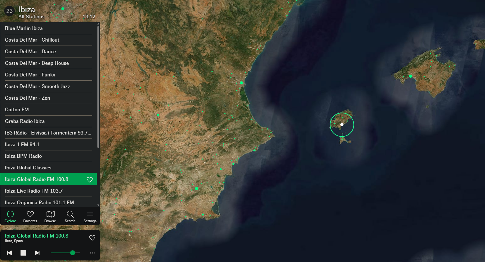

# Radio Garden TV

A small Android TV app that opens [radio.garden](https://radio.garden) full screen and lets you
drive it with an ordinary TV remote. It was built for a Formuler Z11 Pro Max (32-bit Android 11),
where the official Radio Garden phone app can't be installed, but it runs on any Android TV box or
phone with Android 8.0 (API 26) or later.

This is an unofficial personal project. It is not affiliated with or endorsed by Radio Garden;
it simply shows their public website in a WebView.



## What it does

- **Full-screen WebView** on `https://radio.garden/`, listed in both the TV launcher (with a
  banner) and the normal app drawer.
- **On-screen pointer** for remotes without a touchpad. Arrows glide the pointer smoothly, OK
  clicks, and pushing past the top or bottom edge scrolls lists or zooms the globe.
- **Spin mode** (hold OK) for turning the globe with the arrows.
- **Cleaner screen**: requests to Google's ad and consent servers are answered with an empty
  `204`, and injected CSS hides the leftover ad box, the "Get our free Android app" banner and
  the cookie notice. Station streams and artwork come from Radio Garden's own hosts and are never
  blocked.
- **Keeps playing in the background** after you press Home, like a radio.

## Remote controls

| Button | Action |
|---|---|
| Arrows | Move the pointer (eases up to speed when held); past the top/bottom edge scrolls or zooms the globe |
| OK | Click |
| Hold OK | Spin mode: arrows turn the globe (OK or Back to leave) |
| Back | Leaves spin mode, then goes back in the site; press twice on the start page to exit |

Audio keeps playing after Home; exit with Back to stop it.

## Build and install

Requirements:

- JDK 21
- Android SDK with platform 37 (set `sdk.dir` in `local.properties`, or `ANDROID_HOME`)
- `adb` to sideload onto the box

From PowerShell in the project folder (Windows):

```
.\gradlew.bat assembleRelease
adb connect <box-ip>:5555
adb install -r app\build\outputs\apk\release\app-release.apk
```

On macOS or Linux, use `./gradlew assembleRelease` and forward slashes in the APK path.

On the box, turn on network debugging (often under Developer options) so `adb connect` works.
The release build is signed with the debug key so it installs without a keystore; it is meant for
sideloading on your own devices, not for the Play Store.

## Project layout

| File | Purpose |
|---|---|
| `app/src/main/java/.../MainActivity.kt` | WebView setup, remote key handling, pointer glide, clicks, scroll and spin gestures, Back behaviour |
| `app/src/main/java/.../PointerView.kt` | Draws the pointer (white dot, green with a centre ring in spin mode) |
| `app/src/main/java/.../AdFreeClient.kt` | Blocks ad/consent hosts and injects the CSS that hides banners and notices |
| `app/src/main/res/` | Launcher icon, TV banner and on-screen messages |

## Tuning

Constants at the bottom of `MainActivity.kt`:

| Constant | Default | Effect |
|---|---|---|
| `GLIDE_START_DP_S` | 150 | Pointer speed when an arrow is first pressed (dp/s) |
| `GLIDE_MAX_DP_S` | 600 | Top pointer speed (dp/s) |
| `GLIDE_RAMP_S` | 1.2 | Seconds to ease from start to top speed |
| `WHEEL_INTERVAL_MS` | 90 | Scroll/zoom rate while pushing past an edge |
| `SPIN_SWIPE_DP` | 120 | How far one arrow press turns the globe in spin mode |
| `EXIT_CONFIRM_MS` | 2000 | Window for the second Back press to exit |

If the site changes and an ad or banner comes back, update `BLOCKED_HOSTS` or `HIDE_CSS` in
`AdFreeClient.kt`. The CSS matches the stable part of the site's CSS-module class names
(e.g. `_banner_`), so routine site rebuilds shouldn't break it.
